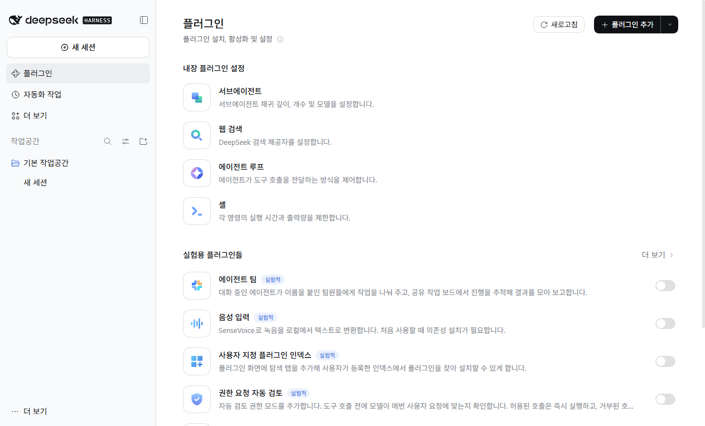

<p align="center">
  
</p>

<h1 align="center">dsh-locale-ko<br>DeepSeek Harness를<br>한국어로 씁니다.</h1>

<p align="center">
  DeepSeek Harness 0.2.2-rc.1의 웹판과 데스크톱판을 한국어로 표시하는 플러그인입니다.
</p>

<p align="center">
  한국어 사전과 팩 구조를 먼저 만들어 공개한 <a href="https://github.com/sayho-pm/dsh-locale-pack">dsh-locale-pack</a>의 Seho(sayho-pm) 님과<br>
  하네스를 오픈소스로 공개한 <a href="https://github.com/deepseek-ai/deepseek-harness">DeepSeek Harness</a> 제작진께 감사드립니다.
</p>

<p align="center">
  DeepSeek의 공식 프로젝트가 아닌 커뮤니티 플러그인입니다.
</p>

<p align="center">
  <a href="#지원-버전"></a>
  <a href="#번역-범위"></a>
  <a href="LICENSE"></a>
</p>

<p align="center">
  <a href="#설치">설치</a> · <a href="#번역-범위">번역 범위</a> · <a href="#표시-패치">표시 패치</a> ·
  <a href="#업데이트와-제거">업데이트와 제거</a> · <a href="#확인한-범위">확인한 범위</a>
</p>

## 설치

### 웹판

```bash
dsh plugin --profile web add github:Burntgogi/dsh-locale-ko#v0.7.0
```

웹판을 다시 시작하세요. 앱의 **플러그인 → 플러그인 추가**에 저장소 주소를 넣고 **지금 활성화**를 눌러도 됩니다. 이 방법은 다시 시작하지 않아도 됩니다.

```text
https://github.com/Burntgogi/dsh-locale-ko#v0.7.0
```

### 데스크톱판

앱의 **플러그인 → 플러그인 추가**에 위 주소를 넣고 설치가 끝나면 **지금 활성화**를 누르세요. 데스크톱 프로필은 앱이 관리하므로 `dsh plugin --profile desktop` 명령은 거부됩니다.

### 언어 선택

브라우저나 OS 언어가 한국어면 바로 한국어로 표시됩니다. 영어로 나오면 **Settings → General → Language**에서 한국어를 고르세요.

설치할 때 `missing peer @deepseek-ai/cordis` 경고가 나올 수 있습니다. cordis는 하네스에 포함된 패키지이며, 시험한 환경에서는 동작에 영향이 없었습니다.

## 번역 범위

플러그인만 설치하면 화면 문구가 번역됩니다. 공식 플러그인 이름과 앱 메뉴는 하네스 파일 안에 있어서 [표시 패치](#표시-패치)를 적용해야 바뀝니다.

| 설치 방법 | 화면 문구 3,843개 | 공식 플러그인 이름·설명 | 메뉴·트레이·종료 안내 |
| --- | --- | --- | --- |
| 플러그인만 | 한국어 | 영어 | 영어 |
| 플러그인 + 웹판 패치 | 한국어 | 한국어 | 해당 없음 |
| 플러그인 + 데스크톱 패치 | 한국어 | 한국어 | 한국어 |

사전에 없는 문구는 영어로 표시됩니다.

## 표시 패치

필요할 때만 적용하세요. 하네스 설치 파일을 직접 고치므로 하네스를 다시 설치하거나 업데이트하면 사라집니다. Node.js가 필요합니다.

### 웹판

`dsh`가 설치된 `node_modules` 경로를 넘긴 뒤 웹판을 다시 시작하세요. npm 전역 설치라면 `npm root -g`의 값입니다.

```bash
node "$HOME/.dsh/profiles/web/node_modules/dsh-locale-ko/tools/patch-web.mjs" "$(npm root -g)"
```

### 데스크톱판 (Windows 전용)

진입 파일의 해시로 공식 Windows 0.2.2-rc.1인지 확인하며, 다르면 멈춥니다. 앱을 완전히 종료한 뒤 PowerShell에서 실행하세요.

```powershell
$ErrorActionPreference = "Stop"
$res = "$env:LOCALAPPDATA\Programs\DeepSeek Harness\resources"
$pack = "$env:USERPROFILE\.dsh\profiles\desktop\node_modules\dsh-locale-ko"
$official = "$res\app.official.asar"
$output = "$env:TEMP\dsh-locale-ko-$(Get-Date -Format yyyyMMddHHmmss).asar"
if (-not (Test-Path $official)) { Copy-Item "$res\app.asar" $official }
node "$pack\desktop\make-asar.mjs" $official $output
if ($LASTEXITCODE -ne 0) { throw "패치를 만들지 못했습니다." }
Copy-Item $output "$res\app.asar" -Force
```

처음 실행할 때 `app.asar`를 `app.official.asar`로 백업합니다. 이 백업은 지우지 마세요. 패치를 다시 만들 때 입력으로 씁니다.

패치한 앱은 언어를 따로 고르지 않은 첫 실행에서 OS 언어와 관계없이 메뉴와 트레이를 한국어로 표시합니다.

되돌리려면 앱을 종료하고 `app.official.asar`를 `app.asar`로 복사하세요.

## 업데이트와 제거

### 지원 버전

DSH 0.2.2-rc.1만 지원합니다. 다른 버전에서는 설치가 거부됩니다. 하네스를 새 버전으로 올리면 그 버전을 지원하는 릴리스가 필요합니다.

### 업데이트

저장소 주소의 태그를 새 릴리스 태그로 바꿔 다시 추가하세요. 아래 `v0.8.0`은 예시입니다.

```bash
dsh plugin --profile web add github:Burntgogi/dsh-locale-ko#v0.8.0
```

### 제거

```bash
dsh plugin --profile web remove dsh-locale-ko
```

## 확인한 범위

Windows 11, Node.js 24, 공식 npm 패키지 0.2.2-rc.1에서 태그를 지정한 Git 설치와 번들 자동 등록, 제거를 시험했습니다. 공개 후 `github:` 지정, HTTPS 주소, Release의 `.tgz` 주소로 명령줄 설치가 되는 것과 웹판·데스크톱 앱의 **플러그인 추가** 화면으로 설치되는 것도 확인했습니다. 한국어 브라우저에서 자동으로 한국어가 선택되는 것과, 패치 전후로 플러그인 화면의 이름이 영어에서 한국어로 바뀌는 것을 확인했습니다. 사전의 키와 자리표시자는 배포본 영어 원문과 대조했습니다.

데스크톱 패치는 공식 원본의 진입 파일을 해시로 확인해 복원한 입력으로 만들었고, 패치한 앱이 부팅되는 것까지 확인했습니다. 공식 원본 파일을 그대로 입력으로 쓴 경우와 macOS, Linux는 시험하지 않았습니다.

번역 오류는 [이슈](https://github.com/Burntgogi/dsh-locale-ko/issues)로 알려 주세요.

## 라이선스

[MIT 라이선스](LICENSE) · Copyright (c) 2026 Burntgogi

dsh-locale-pack의 저작권 고지는 [LICENSE](LICENSE)에, DeepSeek Harness의 MIT 고지와 안내 그림에 쓴 Noto 글꼴의 OFL 고지는 [NOTICE.md](NOTICE.md)에 있습니다. DeepSeek과 DeepSeek Harness는 DeepSeek의 상표입니다.
